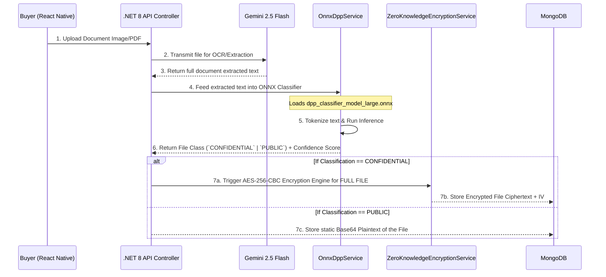

# README: AI-Driven Document Confidentiality Classification for Digital Product Passports (DPP)

This document outlines the architecture and implementation of the **ONNX Document Classification System**, the core AI component powering the Rubber Intelligence Marketplace. This system serves as an intelligent gatekeeper, utilizing an ONNX neural network model to autonomously analyze supply chain documents (Invoices, QIRs) and dynamically enforce **full-file conditional confidentiality**.

## 1. Executive Summary

Instead of relying on unconditional, blanket full-file encryption (which ruins searchability and performance) or manual data sanitization, the system implements **AI-Driven Conditional Privacy**. When a buyer uploads a trading document, the system orchestrates a dual-layer AI approach: 
1. **Generative AI (Gemini)** for semantic extraction and OCR of the entire document.
2. **Deterministic Neural Network (ONNX)** for full-document confidentiality classification based on the extracted text.

The overarching classification from this ONNX model dictates whether the *entire* document file is routed into a decentralized Zero-Knowledge Cryptographic Vault (if classified as `CONFIDENTIAL`) or stored openly (if classified as `PUBLIC`).

---

## 2. The Classification Architecture & Data Flow

The flow for a secure document upload and classification is as follows:

---

## 3. Core Component: `OnnxDppService.cs`

The `OnnxDppService` is the central intelligence node managing the ONNX Inference Session. 

### 3.1 Inference Session (`dpp_classifier_model_large.onnx`)
- **Initialization:** The service loads the pre-trained `.onnx` model into memory during server startup using `Microsoft.ML.OnnxRuntime`.
- **Preprocessing:** The incoming text representing the entire document's contents is converted, normalized (e.g., standardizing diverse currencies like "LKR", "USD" to standard generic tokens), and mapped into tensor input arrays matching the ONNX model's input signature.
- **Classification Output:** The model executes a forward pass and outputs a probability vector. The service maps this vector to a hard classification label (`CONFIDENTIAL` or `PUBLIC`) for the whole file, alongside a confidence score bounded between `0.0` and `1.0`.

### 3.2 Dual-Layer Fallback Heuristics
In scenarios where the ONNX session fails to load due to deployment constraints or corrupted weights, `OnnxDppService` gracefully falls back to a Weighted Term Frequency Heuristic Algorithm to maintain system up-time.

1. **Confidential Lexicon Weighting:**
   - Detects sensitive financial and identity terminologies (e.g., *'price'*, *'amount'*, *'usd'*, *'account'*). 
   - Each occurrence aggressively increments the overall document sensitivity score.
2. **Public Lexicon Weighting:**
   - Detects standard non-commercial domain terminologies necessary for the basic Digital Product Passport (e.g., *'grade'*, *'drc'*, *'warehouse'*, *'port'*).
   - Decrements the sensitivity score.
3. **Thresholding:** If the cumulative net score breaches a predefined threshold, the entire document strictly defaults to the safer `CONFIDENTIAL` tier to prevent accidental data leaks.

---

## 4. Downstream Integration: File-Level Cryptographic Routing

The output generated by the `OnnxDppService` acts as a crucial programmatic switch for the `MarketplaceController.cs` regarding how the physical file is stored.

*   **When Output is `CONFIDENTIAL`:**
    The system recognizes that the document contains sensitive trade secrets. It retrieves a one-time pad (`SecretRequestId`) stored securely alongside the transaction. The `ZeroKnowledgeEncryptionService` derives a 32-byte AES key and 16-byte IV via **PBKDF2/HMAC-SHA256 (100,000 iterations)**. The **entire file** is encrypted into ciphertext, and the original secret key is definitively eradicated from the backend database, ensuring a pure Zero-Knowledge state. When the authorized user needs it, they perform a full-file decryption locally on their device.
*   **When Output is `PUBLIC`:**
    The AI has determined the uploaded material (like standard quality inspection reports with no financial telemetry) represents no risk to the stakeholder. The exact file is converted to Base64 and routed directly to the `ConditionalVault`, where it remains fully readable to participants verifying the DPP.

---

## 5. DPP Hash Verification: Physical-to-Digital Integrity

To ensure that the physical rubber lot precisely matches the digital passport (preventing tampering or substitution fraud), the system implements a rigorous **DPP Hash Verification** mechanism. When a rubber lot is digitized, a unique, deterministic SHA-256 hash (fingerprint) is generated based on its immutable core properties (e.g., grade, aggregate weight, origin). This hash is encoded into a physical QR code affixed to the physical lot. During transaction fulfillment or physical inspection, an authorized user scans the QR code. The system dynamically recomputes the hash from the current database state and compares it against the scanned physical hash. Any discrepancy instantly flags the lot as tampered with, creating an unbreakable, fraud-resistant link between the physical commodity and its secure digital counterpart.

---

## 6. Summary of Novel AI Contributions

1.  **Elimination of Blind Blanket Encryption:** By utilizing the ONNX classifier, the system avoids "encrypt-always" paradigms that hinder accessibility and processing speed. It conditionally applies expensive zero-knowledge encryption *only* when the AI model deduces that the file actually contains private data.
2.  **Autonomous Document Processing:** Manual inspection and categorization of seller invoices are entirely automated via deterministic tokenization, removing the administrative burden of deciding whether an uploaded file should be locked or public.
3.  **Fail-safe Determinism:** Built-in semantic heuristics ensure that the classification pipeline defaults to prioritizing document privacy (failing closed, triggering full-file encryption) when neural network prediction confidences are anomalously low or the model is unavailable.
