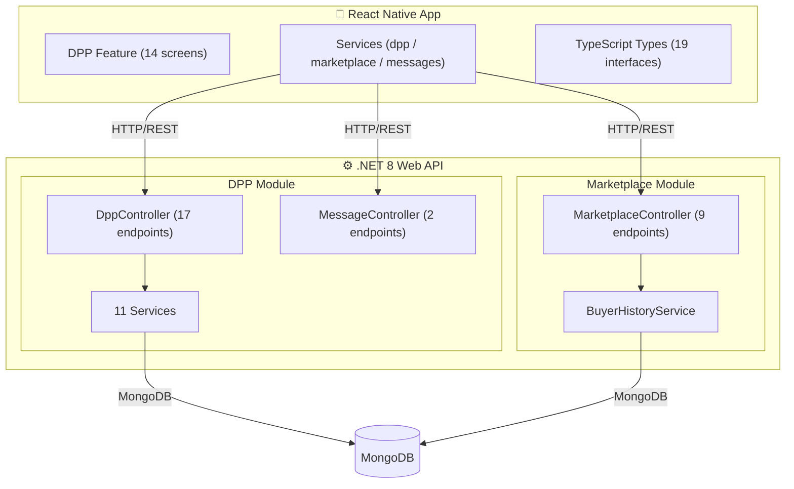

# 🧪 Rubber Intelligence — Component Overview & Status

> **Digital Product Passport (DPP) + Marketplace** system for the Sri Lankan rubber industry.
> .NET 8 Web API (backend) · React Native / Expo (frontend) · MongoDB · Gemini AI · ONNX ML

---

## Architecture at a Glance



---

## 1 · Backend — DPP Module ✅

### 1.1 Controllers

| Controller | Endpoints | Status |
|---|---|---|
| **DppController** | `POST /upload`, `POST /{dppId}/generate-passport`, `GET /passport/{dppId}`, `GET /my-uploads`, `GET /{id}/access`, `GET /{id}`, `POST /request-confidential/{lotId}`, `POST /approve-confidential/{requestId}`, `POST /reject-confidential/{requestId}`, `GET /pending-requests`, `GET /my-requests`, `GET /confidential/{lotId}`, `GET /verify/{lotId}`, `GET /exporter-context/{exporterId}` | ✅ Complete |
| **MessageController** | `POST /messages/{lotId}`, `GET /messages/{lotId}` | ✅ Complete |

### 1.2 Services (11 total)

| Service | Purpose | Status |
|---|---|---|
| **GeminiOcrService** | AI-powered OCR via Gemini API — extracts structured key-value fields from DPP documents and invoices. Supports PDF (File API) and images (inline). | ✅ Complete |
| **OnnxDppService** | ONNX ML model inference — classifies documents as CONFIDENTIAL / NON_CONFIDENTIAL. Also handles RSA-based invoice encryption/decryption and content analysis. | ✅ Complete |
| **DppDocumentProcessingService** | Orchestrates per-field confidentiality classification → AES-256 encryption → HMAC blind-index generation. Keeps controller clean. | ✅ Complete |
| **FieldConfidentialityService** | Rule-based field-level classification (High 0.95, Medium 0.75 confidence) using curated rubber-trade keyword corpus. | ✅ Complete |
| **FieldEncryptionService** | AES-256-CBC field-level encrypt/decrypt with CSPRNG IV, key-version tagging for future rotation. | ✅ Complete |
| **DppEncryptionService** | AES-256-CBC file-level encryption — IV prepended to output for self-contained storage. | ✅ Complete |
| **BlindIndexService** | HMAC-SHA256 blind index for searchable encrypted fields without decryption. | ✅ Complete |
| **ConfidentialAccessService** | Controlled-access workflow — defense-in-depth decryption gate (verifies APPROVED status + exporter identity). | ✅ Complete |
| **DppService** | Assembles `DigitalProductPassport` from extracted fields, SHA-256 hash for integrity verification. | ✅ Complete |
| **ExporterContextService** | Provides exporter profile context (tenure, collaborations, verification status) to buyers reviewing access requests. | ✅ Complete |
| **MessageService** | Secure lot-linked messaging — AES-256-CBC encryption for confidential messages. Decryption only in service layer. | ✅ Complete |

### 1.3 Models (6)

| Model | Description | Status |
|---|---|---|
| `DigitalProductPassport` | DPP entity — grade, quantity, dispatch, hash, lifecycle state | ✅ |
| `DppDocument` | Uploaded document metadata — path, classification, keywords | ✅ |
| `ExtractedField` | Per-field record — encrypted value, IV, blind index, key version, confidence | ✅ |
| `AccessRequest` | Confidential access workflow — PENDING → APPROVED / REJECTED | ✅ |
| `Message` | Lot-linked message with optional AES encryption | ✅ |
| `dpp_classifier_model_large.onnx` | Trained ONNX classification model (~2.9 MB) | ✅ |

### 1.4 DTOs (7)

| DTO | Purpose | Status |
|---|---|---|
| `ClassificationResultDto` | ONNX classification output | ✅ |
| `ConfidentialFieldDto` | Decrypted confidential field response | ✅ |
| `DocumentUploadRequest` | File upload request | ✅ |
| `DppVerificationResponseDto` | Hash verification result | ✅ |
| `ExporterContextDto` | Exporter profile context | ✅ |
| `InvoiceUploadResponseDto` | Invoice upload result with field summaries | ✅ |
| `MessageDto` | Message send/receive payload | ✅ |

---

## 2 · Backend — Marketplace Module ✅

### 2.1 Controller

| Controller | Endpoints | Status |
|---|---|---|
| **MarketplaceController** | `POST /posts` (create), `GET /posts` (list), `POST /posts/{id}/buy`, `GET /transactions`, `POST /transactions/{id}/dpp` (link DPP), `POST /transactions/{id}/invoice` (upload+classify+encrypt), `GET /buyer-history/{buyerId}`, `GET /transactions/{id}/invoice-fields` (decrypt), `GET /transactions/{id}/invoice` (download) | ✅ Complete |

### 2.2 Services, Models, DTOs

| Component | Description | Status |
|---|---|---|
| **BuyerHistoryService** | Analyzes buyer trading history — lot counts, quality averages, DPP verification consistency | ✅ |
| `SellingPost` | Selling post with grade, quantity, price, DPP link, lifecycle statuses | ✅ |
| `MarketplaceTransaction` | Transaction between buyer & exporter — invoice path, encryption metadata, extracted fields | ✅ |
| `BuyerHistoryDto` | Buyer analytics summary | ✅ |
| `InvoiceFieldDecryptedDto` | Decrypted invoice field response | ✅ |

---

## 3 · Frontend — DPP Feature (React Native) ✅

### 3.1 Screens (14 total)

| Screen | Description | Status |
|---|---|---|
| **DocumentUploadScreen** | Buyer uploads DPP documents (image/PDF). Triggers Gemini OCR + ONNX classification. | ✅ Complete |
| **ClassificationResultScreen** | Displays classification result — field breakdown, confidence scores, confidential vs. public fields. Reusable for both DPP and invoice uploads. | ✅ Complete |
| **DppPassportScreen** | Generates and displays the Digital Product Passport with SHA-256 hash verification. | ✅ Complete |
| **DppDetailScreen** | Shows DPP document metadata and provides navigation to passport / verification. | ✅ Complete |
| **ConfidentialAccessScreen** | Exporter requests access to confidential fields; views decrypted data after approval. | ✅ Complete |
| **PendingRequestsScreen** | Buyer reviews pending access requests with exporter context. Approve/reject actions. | ✅ Complete |
| **MarketplaceScreen** | Exporter browses available lots, views buyer history, initiates purchases. | ✅ Complete |
| **CreateSellingPostScreen** | Buyer creates a selling post with grade, quantity, price, and optional DPP link. | ✅ Complete |
| **BuyerDashboardScreen** | Buyer's main dashboard — uploaded documents, transactions, notification-style cards. | ✅ Complete |
| **BuyerProfileScreen** | Buyer profile view with trading statistics. | ✅ Complete |
| **ExporterScannerScreen** | Exporter scans or selects DPP documents for lot linking. | ✅ Complete |
| **LotMessagingScreen** | Real-time lot-linked messaging between buyer & exporter. Supports confidential flag. | ✅ Complete |
| **OrderReceiptScreen** | Post-purchase transaction receipt. | ✅ Complete |
| **InvoiceExtractedFieldsScreen** | Buyer views extracted and decrypted invoice fields with confidentiality indicators. | ✅ Complete |

### 3.2 Services (3)

| Service | API Coverage | Status |
|---|---|---|
| **dppService.ts** | 12 functions — upload, generate passport, get passport, my-uploads, metadata, access control (request/approve/reject/get), verify hash, exporter context | ✅ |
| **marketplaceService.ts** | 8 functions — create post, get posts, buy, transactions, upload invoice, link DPP, buyer history, invoice fields | ✅ |
| **messagesService.ts** | 2 functions — send and get lot-linked messages | ✅ |

### 3.3 Type Definitions

**19 TypeScript interfaces** in `types/index.ts` covering all API request/response shapes. ✅

---

## 4 · What Has Been Achieved ✅

| Feature Area | Achievements |
|---|---|
| **Document Intelligence** | Gemini AI OCR extraction + ONNX document classification (with trained model) |
| **Data Security** | AES-256-CBC field-level & file-level encryption, CSPRNG IV generation, key-version tagging, HMAC-SHA256 blind indexing for searchable encryption |
| **Controlled Access** | Full workflow: Exporter requests → Buyer approves/rejects → Defense-in-depth decryption gate |
| **DPP Generation** | Passport assembly from extracted fields, SHA-256 hash integrity verification |
| **Marketplace** | Full buying flow: post creation → purchase → invoice upload (with Gemini extraction + classification + encryption) → invoice field decryption |
| **Buyer Analytics** | Buyer history service with quality averaging, DPP verification consistency scoring |
| **Exporter Context** | Trust-building profile context — platform tenure, collaboration history, verification status |
| **Secure Messaging** | Lot-linked encrypted messaging between buyer and exporter |
| **Frontend** | 14 fully built React Native screens covering every backend feature with typed API integration |

---

## 5 · What Still Needs to Be Done 🚧

### 5.1 High Priority

| Area | Gap | Description |
|---|---|---|
| 🔑 **Key Rotation** | Backend | `FieldEncryptionService` has key-version tagging but **no actual rotation mechanism** is implemented. Need a migration service to re-encrypt existing records when keys change. |
| 🧪 **Unit & Integration Tests** | Backend + Frontend | No test files found in any module. Critical services (encryption, access control, classification) need comprehensive test coverage. |
| 🔐 **Authorization Middleware** | Backend | Controllers rely on `[Authorize]` + manual `ClaimTypes.NameIdentifier` extraction. No **role-based authorization** (Buyer vs. Exporter) at middleware level — roles are checked implicitly via logic. |
| 📦 **Blockchain/DLT Integration** | Backend | DPP hash is stored in MongoDB only. For true tamper-proof verification, the hash should be anchored to a **distributed ledger or blockchain**. |
| 🔔 **Real-time Notifications** | Backend + Frontend | No push notification or WebSocket infrastructure for access request status changes, new messages, or transaction updates. Frontend relies on manual refresh. |

### 5.2 Medium Priority

| Area | Gap | Description |
|---|---|---|
| 📊 **Admin Dashboard** | Frontend | No admin panel for managing users, reviewing flagged fields (`ManualReviewRequired`), or system monitoring. |
| 🔍 **Search via Blind Index** | Backend + Frontend | `BlindIndexService` is implemented but **no search endpoint or UI** exists for querying encrypted fields by blind index. |
| 🏷️ **DPP Lifecycle Management** | Backend + Frontend | `LifecycleState` field exists (GENERATED, VERIFIED, REINSPECTION_REQUESTED, ACCEPTED, REJECTED) but **no endpoints to transition states**. |
| 📄 **Pagination & Filtering** | Backend | List endpoints (`my-uploads`, `posts`, `transactions`) return all records. Need pagination, sorting, and filtering. |
| 🌐 **Internationalization (i18n)** | Frontend | All UI text is hardcoded in English. No localization support. |
| ⚡ **Offline Support** | Frontend | No local caching or offline-first strategy. All data is fetched from API. |
| 📱 **Error Handling UX** | Frontend | Services mostly `console.error` on failure. Need user-facing error toasts, retry logic, and graceful degradation. |

### 5.3 Low Priority / Polish

| Area | Gap | Description |
|---|---|---|
| 📝 **Audit Trail** | Backend | No logging of access request decisions, decryption events, or data modifications to a dedicated audit collection. |
| 🖼️ **Document Preview** | Frontend | No in-app preview of uploaded DPP documents or invoices (PDF/image viewer). |
| ♻️ **Key Expiry & Revocation** | Backend | Access requests have no expiration. Approved access is permanent until manually revoked. |
| 🧩 **API Versioning** | Backend | No API versioning strategy (`/api/v1/...`). Breaking changes could affect mobile clients. |
| 📈 **Performance Monitoring** | Backend | No APM integration (Application Insights, OpenTelemetry, etc.) for production observability. |
| 🐳 **Containerization** | DevOps | No Dockerfile or docker-compose found for the backend. |

---

## 6 · File Reference

<details>
<summary>Backend — DPP Module</summary>

```
Modules/dpp/
├── Controllers/
│   ├── DppController.cs          (489 lines — 14+ endpoints)
│   └── MessageController.cs      (80 lines — 2 endpoints)
├── DTOs/
│   ├── ClassificationResultDto.cs
│   ├── ConfidentialFieldDto.cs
│   ├── DocumentUploadRequest.cs
│   ├── DppVerificationResponseDto.cs
│   ├── ExporterContextDto.cs
│   ├── InvoiceUploadResponseDto.cs
│   └── MessageDto.cs
├── Models/
│   ├── AccessRequest.cs
│   ├── DigitalProductPassport.cs
│   ├── DppDocument.cs
│   ├── ExtractedField.cs
│   ├── Message.cs
│   └── dpp_classifier_model_large.onnx
├── Services/
│   ├── BlindIndexService.cs
│   ├── ConfidentialAccessService.cs
│   ├── DppDocumentProcessingService.cs
│   ├── DppEncryptionService.cs
│   ├── DppService.cs
│   ├── ExporterContextService.cs
│   ├── FieldConfidentialityService.cs
│   ├── FieldEncryptionService.cs
│   ├── GeminiOcrService.cs
│   ├── MessageService.cs
│   └── OnnxDppService.cs
└── README.md
```

</details>

<details>
<summary>Backend — Marketplace Module</summary>

```
Modules/Marketplace/
├── Controllers/
│   └── MarketplaceController.cs  (414 lines — 9 endpoints)
├── DTOs/
│   ├── BuyerHistoryDto.cs
│   └── InvoiceFieldDecryptedDto.cs
├── Models/
│   ├── MarketplaceTransaction.cs
│   └── SellingPost.cs
└── Services/
    └── BuyerHistoryService.cs
```

</details>

<details>
<summary>Frontend — DPP Feature</summary>

```
src/features/dpp/
├── index.ts
├── screens/
│   ├── BuyerDashboardScreen.tsx
│   ├── BuyerProfileScreen.tsx
│   ├── ClassificationResultScreen.tsx
│   ├── ConfidentialAccessScreen.tsx
│   ├── CreateSellingPostScreen.tsx
│   ├── DocumentUploadScreen.tsx
│   ├── DppDetailScreen.tsx
│   ├── DppPassportScreen.tsx
│   ├── ExporterScannerScreen.tsx
│   ├── InvoiceExtractedFieldsScreen.tsx
│   ├── LotMessagingScreen.tsx
│   ├── MarketplaceScreen.tsx
│   ├── OrderReceiptScreen.tsx
│   └── PendingRequestsScreen.tsx
├── services/
│   ├── dppService.ts
│   ├── marketplaceService.ts
│   └── messagesService.ts
└── types/
    └── index.ts (19 interfaces)
```

</details>

---

*Generated on 2026-03-04. Based on source code analysis of `RubberIntelligence.Backend` and `rubber-intelligence-app`.*
